<!--
  Profile README for github.com/ADG4050  ·  OPTION A (side projects prominent)
  Lives in the repo ADG4050/ADG4050. Images under assets/ must be committed to that same repo.
-->

  

## Hi, I'm Abhishek 👋

PhD researcher at **[IMDEA Networks](https://networks.imdea.org/)** and **[UC3M](https://www.uc3m.es/home)** in Madrid. I work at the intersection of **reinforcement learning, symbolic AI and networked systems**. Previously, I have completed my Masters in Electronics Information Engineering from Trinity College Dublin. Currently I am a visiting PhD student at Dept. of ECE, at Carnegie Mellon University (CMU), in Pittsburgh, PA, USA.  

### 📄 Selected papers

- **SIA** — Symbolic interpretability for anticipatory DRL · *INFOCOM 2026* · [arXiv](https://arxiv.org/abs/2601.22044)
- **SymbXRL** — Symbolic explainable DRL for mobile networks · *INFOCOM 2025* · [arXiv](https://arxiv.org/abs/2601.22024) · [code](https://github.com/RAINet-Lab/SYMBXRL)

## 🎮 Side quests

Before PhD I had built things in Unity and XR. Two of them still make me smile.

<table>
<tr>
<td width="50%" align="center">
 
<b>Naruto VR environment</b> 
An amateur VR world built around the Naruto universe.
</td>
<td width="50%" align="center">
 
<b>XR football-stadium relay</b> 
Real-world stadium feed rebroadcast into an XR scene.
</td>
</tr>
</table>

## 🔬 Featured repositories

  
  

  
  

  📍 Madrid, Spain · currently in Pittsburgh, PA, USA . 

